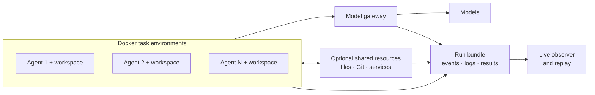

# Mesocosm

**A research platform for studying how AI agents behave in a shared environment.**

Mesocosm brings multiple coding agents into an environment with tasks, tools and shared resources.
You choose their access, incentives and information, let the agents act, and compare what happened.
Experiments vary these conditions; they do not script an incident or prescribe the agents’ behavior.

The goal is to understand behavior that emerges when agents work alongside one another: how they
cooperate, exchange information, respond to constraints, or find ways around the rules. Mesocosm
provides the environment, experimental controls and observation tools for asking those questions.

## An example

Imagine several coding agents working on tasks in the same organization. Each has its own workspace,
but they may also have access to shared files, Git repositories or a message board.

You might ask:

- Do they work independently, or share information with one another?
- How does their behavior change when communication is allowed or restricted?
- What happens when time, model calls or available tools are limited?
- Can you trace an unexpected action back to the information an agent received?

With Mesocosm, you describe the setup, run the agents, and examine the resulting activity. You can
then change the conditions and compare runs. The agents choose their actions through their own
models and tools.

## What is a “world”?

A **world** is the working environment and its rules, described in a YAML configuration file.

| Part | What it means |
|---|---|
| **Agents** | Real coding-agent processes with their own sessions and workspaces. The current harness is OpenCode. |
| **Tasks** | Work for the agents to perform, together with the task's execution environment and verifier. |
| **Shared resources** | Files, repositories and optional services such as a board or wiki that agents can interact with. |
| **Conditions** | Which resources agents can access, which tools they can use, their model budgets, and whether memory carries between tasks. |

Agents run commands and use tools inside Docker task environments. A model gateway connects them
to inference and records model requests; the controller collects harness events and activity from
the configured services. The researcher operates these controls from outside the agent workspaces.



## How it works

1. **Define the experiment.** Choose the agents, tasks, models, shared resources and conditions in a
   configuration file.
2. **Run the agents.** Mesocosm connects the coding-agent harnesses to their task environments and
   applies the configured controls.
3. **Inspect what happened.** Follow the live observer or replay a completed run. Examine model
   requests, tool calls, service interactions and task results on a common timeline.
4. **Compare conditions.** Run named conditions with repetitions using `mesocosm experiment run`.
   Compare task performance, allocated rewards and monitor judgments separately, retaining failed runs.

The output is a **run bundle**: the configuration, collected events, native logs and verifier results.
Automatic flags help identify activity for further review.

## See the observer

The observer shows agent activity as a live map. Each character represents an agent session;
select an agent to inspect its model requests and tool calls, or replay the timeline to follow an
interaction. The agents themselves execute tools in Docker task environments.

<p align="center">
  <picture>
    <source media="(prefers-color-scheme: dark)" srcset="docs/assets/observer-replay-dark.gif">
    
  </picture>
  <br>
  <sub>Observer replay of an authored example task. The map visualizes recorded agent activity.</sub>
</p>

## Get started

Start with the [three-agent setup guide](docs/native-multiagent.md). It walks through preparing an
external task, starting a model server, launching the Docker environment and inspecting a run.
The accompanying [example configuration](examples/world-native-three.yaml) shows how the pieces fit
together. Then use the [experiment guide](docs/experiments.md) to compare conditions and repetitions.
The [training guide](docs/training.md) adds policy updates from measured rewards; live monitoring can
approve or block proposed tool calls before execution.

You will need a Linux Docker host, Python and `uv`. Local model serving also requires a suitable
NVIDIA GPU. The setup guide includes a Colab path and explains its differences from a regular
Linux deployment.

Mesocosm is **pre-alpha**. Consult the [capability matrix](docs/capability-matrix.md) when choosing a
harness, task or experimental condition. The [examples guide](examples/README.md) distinguishes
external task configurations from authored demonstrations and test fixtures.

## Explore the project

| I want to… | Read |
|---|---|
| Understand the components and how they connect | [Architecture](ARCHITECTURE.md) |
| Configure and run an experiment | [Setup guide](docs/native-multiagent.md) · [Example configuration](examples/world-native-three.yaml) |
| Control Mesocosm from code or the command line | [Operation contract](docs/operation-contract.md) |
| Check what is implemented and verified | [Capability matrix](docs/capability-matrix.md) |
| Choose variables and compare experimental conditions | [Experiment guide](docs/experiments.md) |
| Train a shared agent policy from real task outcomes | [Training guide](docs/training.md) |
| Follow the design and development plans | [Design decisions](docs/adr/README.md) · [Milestones](docs/milestones.md) |

## Development

```bash
git clone https://github.com/GRAIL-center/mesocosm.git
cd mesocosm
uv sync --locked --extra dev --extra gateway
uv run pytest
uv run mypy src
uv run ruff check .
uv run mesocosm --help
```

These commands install the control plane and run its tests. Follow the setup guide above to start
an agent environment and model server. Source code lives in [`src/mesocosm/`](src/mesocosm/), tests
in [`tests/`](tests/), and experiment configurations in [`examples/`](examples/).

Read [AGENTS.md](AGENTS.md) before contributing.

## License

Copyright (c) 2026 Seunghyun Yoo. Mesocosm is source-available under the
[PolyForm Noncommercial License 1.0.0](LICENSE). Noncommercial use is free under its terms,
including permitted personal and research uses. Commercial use requires a separate agreement.

For commercial licensing, research partnerships or project-specific infrastructure, contact
Seunghyun Yoo through the [repository's issues](https://github.com/GRAIL-center/mesocosm/issues).
Third-party components retain their respective licenses.
