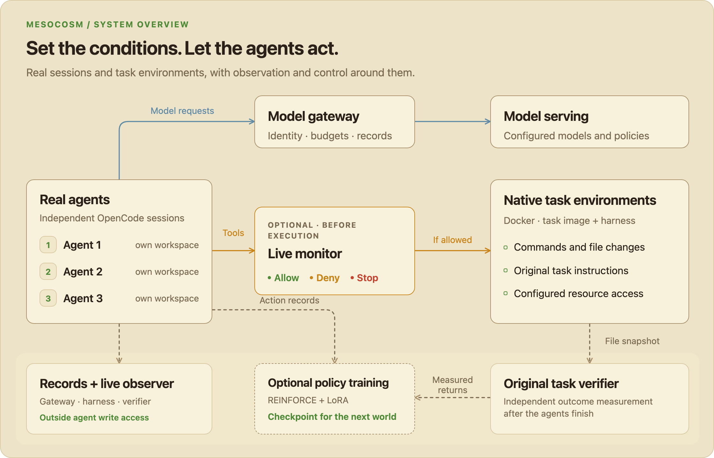

<p align="center">
  <picture>
    <source media="(prefers-color-scheme: dark)" srcset="docs/assets/banner-dark.png">
    
  </picture>
</p>

<p align="center">
  <strong>Research infrastructure for multi-agent behavior in real task environments.</strong>
</p>

<p align="center">
  <a href="docs/native-multiagent.md">Start with three agents</a> ·
  <a href="docs/experiments.md">Design experiments</a> ·
  <a href="docs/training.md">Train a policy</a> ·
  <a href="ARCHITECTURE.md">Architecture</a>
</p>

Mesocosm connects independent AI coding agents to executable tasks, tools and shared resources.
You choose their access, budgets, memory, incentives and monitoring. The agents choose their actions;
Mesocosm runs the environment and collects the evidence needed to study what happens.

Use it to investigate cooperation, information sharing, rule violations and other behavior that emerges
when agents work alongside one another. For example, give three agents the same software repair task,
keep its verifier fixed, and compare individual rewards with team rewards. Examine the work they
produce, the information they exchange and the actions a monitor allows or blocks.

## How the system fits together

A **world** describes the agents, tasks, resources and rules for a run. Each agent has its own process,
session and workspace, even when agents share a model. Native tasks run in Docker environments with
their original instructions and verifiers; optional shared files and services let agents interact.

<p align="center">
  <picture>
    <source media="(prefers-color-scheme: dark)" srcset="docs/assets/system-overview-dark.png">
    
  </picture>
  <br>
  <sub>Conditions shape the environment. Agents act. The control plane observes, measures and can intervene. <a href="docs/assets/system-overview-light.png">View full size</a>.</sub>
</p>

Three workflows use the same foundation:

| Workflow | What you do | What you get |
|---|---|---|
| **Run a world** | Connect agents to an external task and configure their environment. | Agent activity, tool traces and original verifier outcomes. |
| **Compare conditions** | Vary selected controls across named conditions and repeated trials. | Separate records for task performance, incentives and monitor judgments. |
| **Train a policy** | Use measured rewards and verified action traces to update a shared policy between worlds. | REINFORCE/LoRA checkpoints used by the agents in the next world. |

Policy weights stay fixed during each training world. The optional live monitor reviews proposed
**tool calls** before execution and can allow or deny a call, or terminate the session. The observer provides a
view of activity; the monitor provides decisions.

## What can you control?

| Condition | Examples | Research question |
|---|---|---|
| **Access & communication** | Directed messages, channel membership, repository/service grants and internet access | What changes when agents can exchange information? |
| **Budgets & memory** | Individual and team request/token quotas, shared concurrency; reset or retained sessions | How do constraints and prior experience affect decisions? |
| **Incentives** | Individual, team-mean or mixed rewards; original verifier or peer verdicts | How does the reward structure affect the work agents choose to do? |
| **Monitoring** | Reviewer, rubric, evidence visibility; posthoc review or before-tool intervention | What can a monitor detect, and how does intervention affect the run? |

Configure these controls in YAML. The [experiment guide](docs/experiments.md) explains the supported
combinations and how to compare them. Original task outcomes, allocated rewards and monitor judgments
remain separate, and failed or missing observations stay in the experiment record.
The [research controls guide](docs/research-controls.md) covers access graphs, joint live review,
verified stopping, repeated baselines and held-out evaluation.

## See the agents at work

The observer maps agent sessions and recorded activity onto a shared timeline. Select an agent to
inspect model requests and tool calls, follow a live run, or replay an interaction afterward.

<p align="center">
  <picture>
    <source media="(prefers-color-scheme: dark)" srcset="docs/assets/observer-replay-dark.gif">
    
  </picture>
  <br>
  <sub>The actual observer interface, replaying an authored fixture. The map visualizes activity; agents execute tools in Docker task environments.</sub>
</p>

Collected configurations, model and harness records, tool events and verifier results form a
**run bundle** for inspection and replay. Research records are kept outside agent workspaces.

## Start with three agents

The current stack combines **OpenCode** agent harnesses, **Harbor-format** tasks and **Docker**
environments. The native setup guide uses **vLLM** for model serving. Run the control plane on a
Linux Docker host with Python and `uv`; local model serving and policy training need a suitable GPU.

```bash
git clone https://github.com/GRAIL-center/mesocosm.git
cd mesocosm
uv sync --locked --extra gateway
uv run mesocosm --help
```

This installs the control plane. Continue with the workflow you need:

1. **Launch your first world.** Follow the [three-agent setup guide](docs/native-multiagent.md) to
   prepare an external task, model server and private configuration. Start from the
   [native world example](examples/world-native-three.yaml).
2. **Compare conditions.** Follow the [experiment guide](docs/experiments.md) to define variants,
   run repetitions and inspect the resulting records.
3. **Add policy updates.** Follow the [training guide](docs/training.md) to collect rollouts,
   update a shared policy and deploy its checkpoint into the next world.

Mesocosm is **pre-alpha**. Native execution currently supports Debian/Ubuntu single-container
filesystem tasks. The [capability matrix](docs/capability-matrix.md) documents supported settings,
verification evidence and deployment limits, including the Colab path. The
[examples guide](examples/README.md) separates external-task configurations from authored fixtures.

## Go deeper

| Resource | Use it for |
|---|---|
| [Architecture](ARCHITECTURE.md) | Components, data flow and control boundaries |
| [Operation contract](docs/operation-contract.md) | CLI and programmatic interfaces |
| [Capability matrix](docs/capability-matrix.md) | What is implemented, verified and still limited |
| [Design decisions](docs/adr/README.md) · [Milestones](docs/milestones.md) | Why the system works this way and what comes next |

<details>
<summary><strong>Developing Mesocosm</strong></summary>

Read [AGENTS.md](AGENTS.md) before contributing. Code lives in [`src/mesocosm/`](src/mesocosm/),
tests in [`tests/`](tests/), and configurations in [`examples/`](examples/).

```bash
uv sync --locked --extra dev --extra gateway
uv run pytest
uv run mypy src
uv run ruff check .
```

</details>

## License

Copyright (c) 2026 **Seunghyun Yoo**. Mesocosm is source-available under the
[PolyForm Noncommercial License 1.0.0](LICENSE). Noncommercial use is free under its terms,
including permitted personal and research uses. Commercial use requires a separate agreement.

For commercial licensing, research partnerships or project-specific infrastructure, contact
Seunghyun Yoo through the [repository's issues](https://github.com/GRAIL-center/mesocosm/issues).
Third-party components retain their respective licenses.
