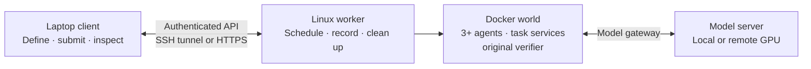

# Run worlds from your laptop

Prepare a world or condition experiment on your laptop, then submit it to a Linux execution worker.
The worker runs the complete environment and retains its records. Closing the client connection does
not stop an accepted job. You can reconnect to inspect progress, stop it explicitly or fetch results.



Docker runs on the worker. The client needs Python and Mesocosm, with no local Docker or GPU required.
Inference can use a separate GPU server or a configured compatible provider. Remote job submission
currently accepts **finite research worlds and condition experiments**. Direct local training and
persistent-mode commands remain separate; neither is a remote job kind.

## Prepare the worker

Use a Linux host with a local Docker daemon and Docker Compose, Python 3.11–3.13, `uv` and a complete
Mesocosm source checkout. The worker must see the same kernel and host process information as its
containers: pointing a Mac client or an isolated controller at a remote Docker socket does not meet
the containment checks. The historical Colab shared-PID wrapper is not supported for worker jobs.

Install from the checkout on the worker:

```bash
uv sync --locked --extra gateway
uv run mesocosm worker serve --help
```

Provision the same random bearer token, at least 32 characters, in `MESOCOSM_WORKER_TOKEN` on the
worker and client through your normal secret-management process. Keep the worker state directory
private; an existing directory must have mode `0700`. Run from the checkout:

```bash
uv run mesocosm worker serve \
  --repo-root "$PWD" \
  --root "$HOME/.local/share/mesocosm-worker" \
  --host 127.0.0.1 \
  --port 8765
```

The source checkout supplies `spike/docker/` build assets; installing the Python wheel alone is not
enough for the worker. Keep this process running using your Linux service manager. The worker cleans
unfinished jobs on startup, so retain its state directory across restarts.

The worker runs one active job and admits at most 16 unfinished jobs by default (`--max-pending`). Current worlds use
fixed subnets. A host-wide lease prevents a second managed worker from starting; do not run a manual
Mesocosm stack alongside it. A failed cleanup blocks further execution until recovery succeeds.

## Connect the client

Install Mesocosm from the same checkout revision on your laptop. The base installation is sufficient
for client commands:

```bash
uv sync --locked
```

For a worker reachable through SSH, forward its loopback port. Replace `mesocosm-worker` with your
configured SSH host alias:

```bash
ssh -N -L 18765:127.0.0.1:8765 mesocosm-worker
```

In another client terminal, with the token already in its environment:

```bash
export MESOCOSM_WORKER_URL=http://127.0.0.1:18765
uv run mesocosm execution capabilities --json
```

Alternatively use an HTTPS endpoint backed by your TLS reverse proxy. The client refuses plaintext
HTTP outside loopback and does not follow redirects. `--worker` overrides `MESOCOSM_WORKER_URL`;
`--token-env` selects a different token environment variable. Tokens are not CLI argument values.

The capability response checks worker prerequisites. A backend reported as `supported` means its
host prerequisites are available; each task still has to pass actual PID-containment and egress
checks before agents execute. It does not establish real-agent acceptance.

## Submit, inspect and fetch

Prepare an external task and a world using the [native setup guide](native-multiagent.md), or an
experiment using the [condition guide](experiments.md). Every submitted variant must use the research
profile, at least three agents, finite comparison tasks and `containment: required`.

```bash
uv run mesocosm execution submit /path/to/world.yaml --json

# For a repeated condition experiment:
uv run mesocosm execution submit /path/to/experiment.yaml --kind experiment --json
```

Submission saves a local receipt and the exact archive before sending the request. By default they
live under `.mesocosm-execution/`, named with the job ID. Save these as private local artifacts outside
version control. If the connection drops before you receive a response, resume using that receipt:

```bash
uv run mesocosm execution submit --resume .mesocosm-execution/JOB_ID.json --json
```

The same job ID and package digest identify the same submission. Resuming does not create a second
observation. Reusing an ID with changed inputs fails; a genuinely new trial needs a new ID.

Use the returned job ID to inspect or control it:

```bash
uv run mesocosm execution status JOB_ID --json
uv run mesocosm execution events JOB_ID --json
uv run mesocosm execution wait JOB_ID --json
uv run mesocosm execution fetch JOB_ID --out ./collected-job --json
```

`status` lists available run IDs. `events --run-id RUN_ID` reads that run's event stream; without it,
the command reads job lifecycle events. Continue from the returned `next_offset` using `--offset`.
`wait` polls until the job is terminal; interrupting it or losing the connection only detaches the
client. To stop execution and request owned-resource cleanup, use:

```bash
uv run mesocosm execution stop JOB_ID --json
```

Stop is a request, not proof that cleanup has finished. Inspect the terminal job status and cleanup
receipt. Fetch is available only for terminal jobs and requires a new output directory. It verifies
the downloaded archive before exposing the extracted result. Original run bundles are under
`runs/<run-id>/`; use existing `report`, `diagnose` and `observe serve` commands on those directories.
Paths inside original manifests retain their worker locations. Offline probe scoring therefore needs
an explicit local `--probe` file; submission assets are not part of the result export.

## Inputs, models and private records

The client copies declared task directories and referenced skills, wiki documents, replay inputs and
capture probes. Dataset references are materialized before submission. It preserves task bytes and
file modes, hashes the package and refuses links, special files, path traversal and oversized inputs.
It does not upload your whole checkout. Archive limits are 20,000 indexed entries, 256 MiB per file
and 512 MiB total file content; archive metadata has a separate bounded allowance.
The same limits apply to result archives. Larger records remain on the worker and require direct
operator transfer; the API does not silently omit them to fit a download.

Client gateway endpoints and control keys are stripped. The worker creates fresh endpoints and
credentials in a separate resolved configuration. Declared model upstreams remain in the submission;
their addresses must be reachable from the worker's gateway. For the default vLLM route, configure
`worker serve --vllm-host HOST --vllm-port PORT` as needed.

Model API keys stay on the worker. A manifest names an environment variable through `api_key_env`;
the worker must have that variable and explicitly allow its name with the repeatable option
`--model-key-env NAME`. This is an operator allowlist, not provider-bound secret isolation: a trusted
submitter can select an upstream that receives an allowed credential.

The worker API therefore assumes **one trusted research operator**. It is not a multi-tenant service
for untrusted task authors. Explicit task credentials or MCP headers/environment values are still
submitted inputs. Result exports contain job receipts, experiment summaries and original run bundles;
they exclude generated Compose configuration, workspaces and unrelated worker files. Original bundle
bytes are unchanged and can contain run credentials or sensitive task data. Treat submissions,
receipts and fetched results as private artifacts.

## Failures and current evidence

| Situation | Behavior |
|---|---|
| Client disconnects after acceptance | Execution continues on the worker; reconnect using the saved job ID. |
| A queued job is stopped | It is cancelled without launching a world. |
| A running job is stopped or fails | Owned resources are cleaned before the next job may run. |
| Worker restarts with unfinished jobs | It cleans recorded ownership and marks jobs interrupted; it does not replay observations. |
| Cleanup cannot be verified | Status becomes `failed_cleanup`; new execution is blocked. |
| Worker or host remains down | No independent cleanup watchdog runs; recovery occurs when the worker starts again. |

Local package, API, lifecycle, client and Docker command-boundary tests exercise these contracts.
They do not demonstrate a real Linux worker running three real agents, native application services,
actual tools and the original verifier. No Linux execution host was available for this implementation;
that acceptance run remains **unverified**. Existing earlier Colab evidence does not verify this
worker or its stricter containment path. See the [capability matrix](capability-matrix.md) and
[ADR-0051](adr/0051-remote-world-execution.md).
